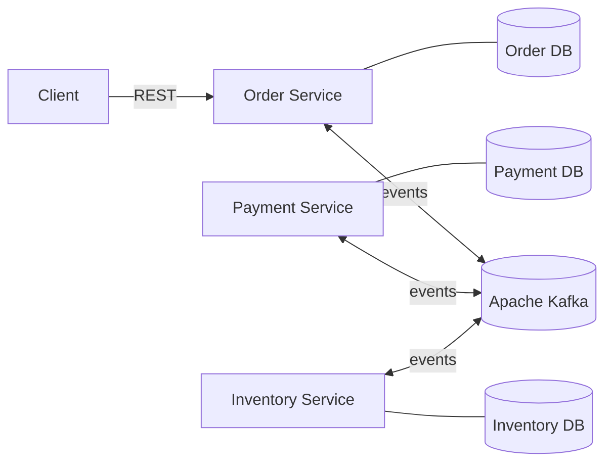
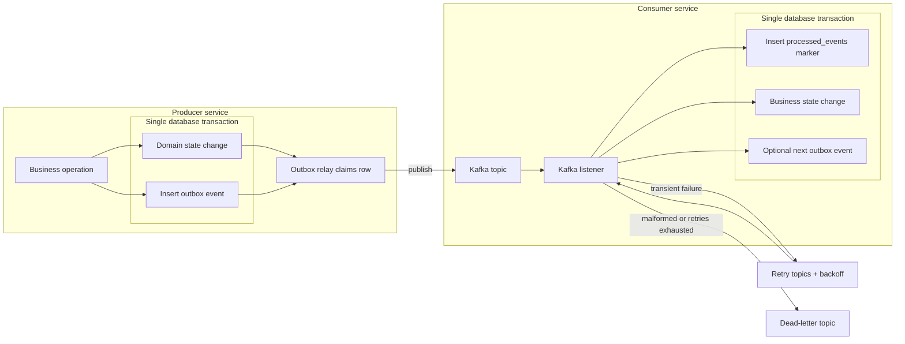
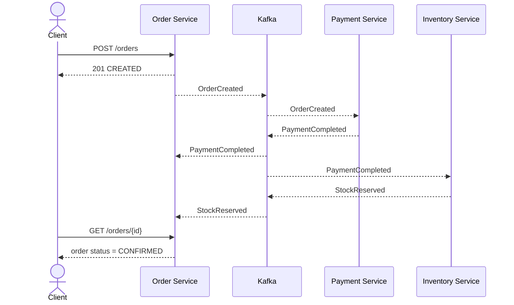
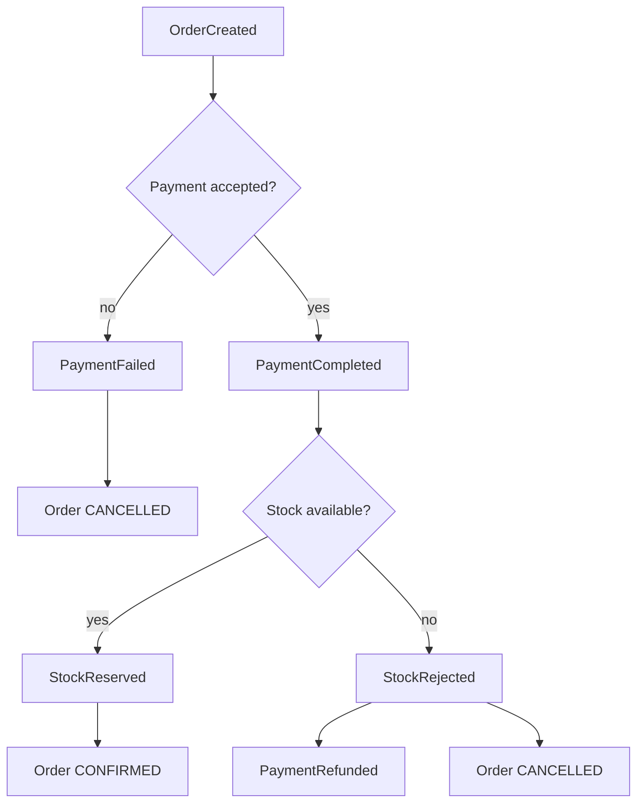

# Kafka Saga Demo

[](../../actions/workflows/ci.yml)

This is the project I used to move past Kafka's basic producer/consumer examples. It models a small order flow, but the real subject is everything that starts to matter when messages are duplicated, delayed, reordered or sent while another service is down.

## Why I built it

An order is processed by three independent services:

- **Order Service** creates an order and tracks its final status.
- **Payment Service** approves or rejects a payment and handles refunds.
- **Inventory Service** stores order lines and reserves stock.

There is no central coordinator. Each service reacts to Kafka events and emits the next event. If stock reservation fails after a successful payment, the order is cancelled and the payment is refunded.

I deliberately kept the business domain small. That left room to focus on the less visible parts of event-driven systems: the database/Kafka dual write, idempotency, recovery after outages and the fact that Kafka does not order records across topics.

## Architecture



Each service owns a separate database. When a service changes its state, it saves the outgoing event in the same transaction. A small outbox relay publishes that event afterwards.

I use `orderId` as the Kafka key, so records for one order stay ordered within a topic. Events share a small envelope containing `eventId`, `eventType`, timestamp, version and `orderId`.

### Reliable message processing



The two transaction boundaries are the important part of this diagram. A business change cannot commit without its outbox row. On the receiving side, the idempotency marker cannot commit without the business change. There is still a small window in which the relay can publish the same event twice, so consumers must handle duplicates.

## Happy path



Inventory also listens to `OrderCreated` because it needs a local snapshot of products and quantities before it can reserve anything.

## When things go wrong



Business failures produce normal domain events. Technical failures take a different route:

- transient processing failures go through retry topics with exponential backoff,
- malformed events skip retries and go directly to a dead-letter topic,
- repeatedly failing events are moved to DLT after the retry budget is exhausted,
- a Kafka outage leaves events in the database outbox until the broker recovers,
- a stopped consumer resumes from its committed offset after restart,
- an event that arrives before its prerequisite is stored as pending instead of hoping that a short retry will be long enough.

## What is implemented

- a choreography-based saga, including payment refund as a compensating action,
- a transactional outbox in all three services,
- idempotent consumers backed by `processed_events`,
- retry topics with exponential backoff and service-specific DLTs,
- correlation IDs carried in Kafka headers and MDC,
- pessimistic locking for stock and advisory locking for cross-topic races,
- outbox row claiming, so two instances do not publish the same pending row at the same time.

## Guarantees and trade-offs

The honest guarantee here is **at-least-once delivery**. The project does not claim end-to-end exactly-once processing.

The outbox prevents the dual-write problem between PostgreSQL and Kafka. A crash after Kafka acknowledges a message but before the outbox row is marked as published can still cause a duplicate. Consumers therefore make the business operation and the `processed_events` marker part of one database transaction.

Some choices are intentionally modest:

- ordering is guaranteed only per key, partition and topic — never across different topics,
- events that arrive out of order are handled by explicit state rather than a short retry window,
- the event contract is currently shared as a Java module instead of using Schema Registry,
- the local setup has one Kafka node and replication factor `1`; it demonstrates behaviour, not high availability,
- processed-event retention is finite and must be longer than the accepted replay window.

## Running locally

The quickest path requires only Docker with Docker Compose:

```bash
cp .env.example .env
docker compose up --build -d
```

The first build may take a few minutes. It starts Kafka, PostgreSQL, Kafka UI and all three services. Check that the application containers are healthy:

```bash
docker compose ps
```

| Component | Address |
|---|---|
| Order API | `http://localhost:8080` |
| Order health | `http://localhost:8080/actuator/health` |
| Payment health | `http://localhost:8081/actuator/health` |
| Inventory health | `http://localhost:8082/actuator/health` |
| Kafka UI | `http://localhost:8088` |

Stop the environment while preserving PostgreSQL data:

```bash
docker compose down
```

Remove the environment together with its database volume:

```bash
docker compose down -v
```

For local development without application containers, Java 26 is required. The included Maven Wrapper downloads the expected Maven version automatically:

```bash
./mvnw -DskipUnitTests=true package
```

## Trying the flow

Create an order that should complete successfully:

```bash
curl -i http://localhost:8080/orders \
  -H 'Content-Type: application/json' \
  -d '{
    "customerId": "customer-1",
    "items": [
      {"productId": "p-1", "quantity": 2, "unitPrice": 10.00}
    ]
  }'
```

Read its current state using the ID returned in the response:

```bash
curl http://localhost:8080/orders/<order-id>
```

To exercise the other paths, change the request:

- product `p-3` has no stock and triggers rejection plus refund,
- total amount above `5000.00` triggers `PaymentFailed`,
- total amount `13.13` simulates a declined card.

## Tests

Run the fast unit-test suite:

```bash
./mvnw test
```

Run the complete suite with Docker available:

```bash
./mvnw verify
```

The integration suite starts actual service JARs and disposable Kafka/PostgreSQL containers. It covers:

- successful, rejected-payment and out-of-stock saga paths,
- duplicate delivery without a duplicate business effect,
- out-of-order events,
- retry timing and dead-letter routing,
- Kafka and Inventory Service outages followed by recovery,
- outbox persistence and eventual draining,
- `correlationId` propagation,
- two Payment Service instances sharing partitions,
- concurrent order processing and basic performance characteristics.

CI keeps the quick unit tests and the slower Testcontainers suite in separate jobs.

## Following an order through the system

Services produce structured ECS JSON logs. Consumer logs include:

- `correlationId`, `eventId` and `orderId`,
- topic, partition and offset,
- event type and state transitions.

DLT logs also include the original topic, partition, offset, exception type and reason. The same `correlationId` follows the whole saga, which makes it possible to find all logs for one request without guessing from timestamps.

Kafka UI can be used to inspect topics, consumer groups, headers, retries and dead-letter records.

## What I learned

The first version of this project published directly after changing the database. Adding failure tests made the gap obvious: producer idempotence does not solve a database/Kafka dual write, and a successful send can still be followed by a duplicate.

The other important lesson was ordering. Using the same key helps only inside one topic and partition. `PaymentCompleted` can still reach Inventory before its `OrderCreated` snapshot, so that case needs explicit state rather than a conveniently chosen retry delay.

Finally, the most useful tests were not the happy-path ones. Stopping Kafka, stopping a service, sending the same event twice and running two consumers exposed the assumptions that were otherwise easy to miss.

## What I would add next

This is still a learning project rather than a production platform. The next useful steps would be:

- Prometheus metrics for consumer lag, retry/DLT counts and outbox backlog,
- a controlled DLT replay tool,
- contract evolution with Schema Registry and Avro or Protobuf,
- distributed tracing with OpenTelemetry,
- security configuration for Kafka and PostgreSQL,
- a multi-broker Kafka environment for replication and failover tests.

## Tech stack

Java 26 · Spring Boot 4 · Spring Kafka · Apache Kafka 4 · PostgreSQL · Flyway · Testcontainers · Maven

## Architecture decisions

The reasoning behind the main design choices is documented in [Architecture Decision Records](docs/adr/README.md).

## License

This project is available under the [MIT License](LICENSE).
